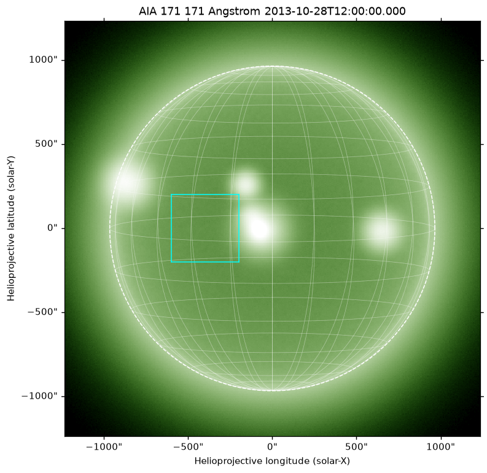
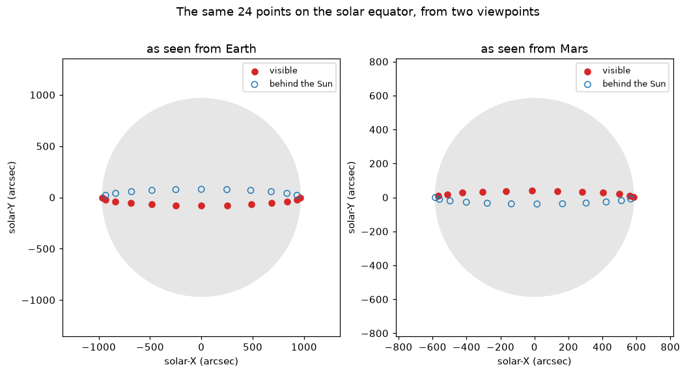
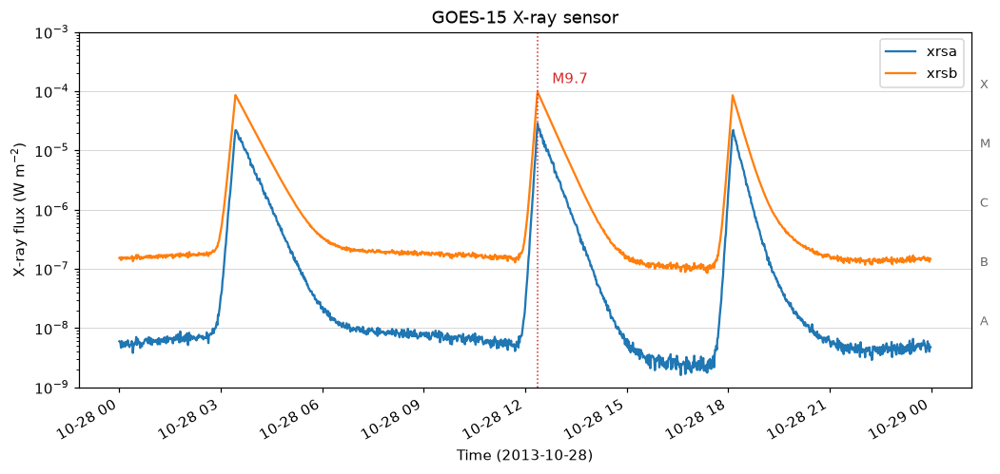
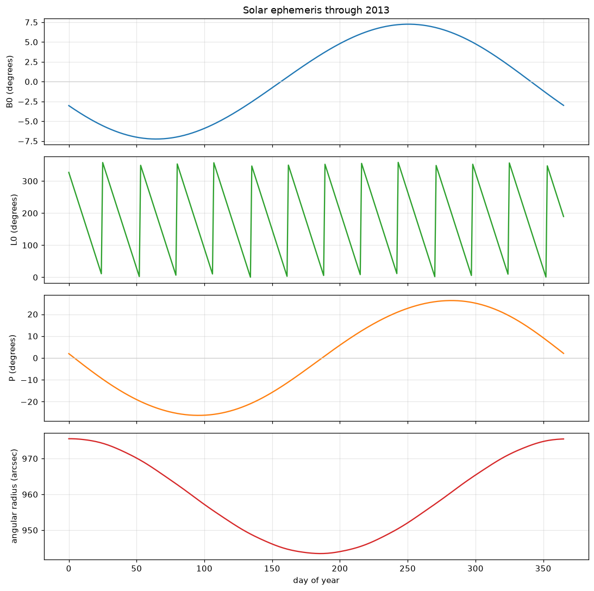
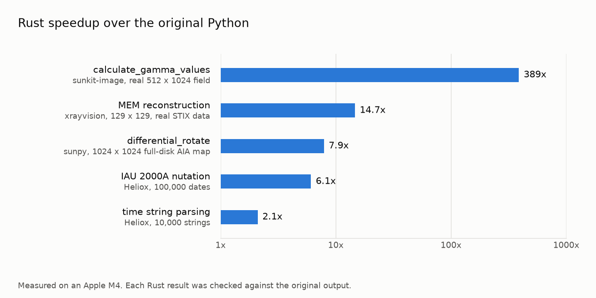

# Heliox

Heliox is a solar physics toolkit with a Python API and a Rust core. It rebuilds the core of [SunPy](https://sunpy.org) from scratch. You get a coordinate-aware `Map` for solar images, a `TimeSeries` for instrument light curves, five solar coordinate frames inside astropy's transform graph, and the ephemeris, rotation and search machinery that ties them together.

The Python layer keeps the familiar SunPy-style interface and hands the numerical work to `heliox._core`, an extension module written in Rust with PyO3. Solar ephemerides, nutation, coordinate matrices, time parsing, image interpolation, map geometry, header logic, query algebra and the synthetic sample data are all computed in Rust. Every ported function was checked against the original Python implementation before that implementation was removed.

Everything runs offline. The sample data is generated on your machine the first time you use it, so there is nothing to download and every example is reproducible.

```python
import astropy.units as u
import heliox.map
from heliox.data.sample import AIA_171_IMAGE

aia = heliox.map.Map(AIA_171_IMAGE)
aia.peek(draw_limb=True, draw_grid=15 * u.deg)
```



## Installing

Heliox needs Python 3.10 or later. Each [GitHub release](https://github.com/pragyaangaur/Heliox/releases) carries prebuilt wheels for Linux (x86_64, aarch64 and musl), macOS (Intel and Apple Silicon) and Windows, so installing from a wheel needs no Rust toolchain. Download the wheel for your platform and install it with pip:

```bash
pip install heliox-0.2.0-cp310-abi3-<platform>.whl
```

To build from source you also need Rust, which you can install from [rustup.rs](https://rustup.rs). The build uses [maturin](https://www.maturin.rs) and produces one extension module, `heliox._core`, next to the Python package.

```bash
git clone https://github.com/pragyaangaur/Heliox
cd Heliox
pip install -e .
```

The documentation is published at [pragyaangaur.dev/Heliox](https://pragyaangaur.dev/Heliox/).

## How it is built

Heliox has two layers. The Python package in [`heliox/`](heliox/) holds the public API: the classes, the astropy frame registrations, units, docstrings and plotting. The Rust crate in [`core/`](core/) holds the computation. Each area of Heliox has its own Rust submodule, so `heliox.sun` calls `heliox._core.sun` and `heliox.map` calls `heliox._core.maps`.

| Area | What runs in Rust |
| --- | --- |
| `sun` | Solar ephemeris, B0, L0 and P angles, Carrington rotation with a Brent root finder, rotation and limb darkening laws, IAU 2000A/2006 nutation and obliquity, and the built-in solar system ephemeris (ports of ERFA's `epv00`, `plan94`, `moon98` and `pfw06`) |
| `coordinates` | IAU solar rotation elements, frame rotation matrices, helioprojective and heliocentric projection, great arcs, limb geometry, surface intersection and far-side visibility |
| `time` | Parsing of every supported time string format, and `TimeRange` arithmetic using astropy's two-double representation |
| `map` | Header rotation matrices, keyword logic, submap bounds, resample and superpixel arithmetic, contour levels, display limits, source matching, path handling and summary formatting |
| `image` | Interpolation compatible with `scipy.ndimage` (orders 0, 1 and 3), resampling and the affine transform used for rotation |
| `physics` | Pixel sampling for differential rotation |
| `timeseries` | GOES flare classes and the CSV comment header reader |
| `net` | Reduction of search queries to sums of products, and catalogue matching |
| `io` and `util` | FITS header card handling, wavelength units, file type detection and deprecation messages |
| `visualization` | Colour table curves, grid lines and rectangle overlays |
| `data` | Generation of the synthetic AIA, HMI, LASCO, GOES and NOAA sample data |

Python keeps the parts that are astropy, pandas or matplotlib objects by nature, such as `SkyCoord`, `Time`, `Quantity`, `DataFrame` and plot artists. It also keeps a few paths where only the standard library gives identical behaviour, such as glob handling on Windows.

### How the port was checked

Each area was ported on its own branch. Before the old Python code was removed, a comparison script called the old and new code on thousands to hundreds of thousands of inputs, including real sample data, random arrays, NaN and infinite values, empty inputs and edge dates. Most functions give bit-identical results. The rest differ by a few units in the last place, for reasons that were traced and recorded, such as a different summation order or a fused multiply-add in a compiled library. The full test suite of more than 1,000 tests passes on Linux with Python 3.10 to 3.13, and on macOS and Windows with Python 3.12.

The ERFA routines were transcribed from the C sources of [ERFA](https://github.com/liberfa/erfa), which is BSD-3-Clause licensed and derived from SOFA. Its licence notice is kept at the top of every file that contains transcribed code or tables.

## A quick tour

### Images that know where they are pointing

A map bundles the array, its metadata and the coordinate frame that turns pixel indices into positions on the Sun. Cropping, rotating and overlaying can then be expressed in physical terms.

```python
from astropy.coordinates import SkyCoord

# Crop by position on the Sun.
corner = SkyCoord(-700 * u.arcsec, -300 * u.arcsec, frame=aia.coordinate_frame)
region = aia.submap(corner, width=600 * u.arcsec, height=600 * u.arcsec)

# Rotate so that solar north is up. The WCS is updated to match.
upright = region.rotate()

# The same physical point is found correctly in either map.
target = SkyCoord(-400 * u.arcsec, 0 * u.arcsec, frame=aia.coordinate_frame)
upright.world_to_pixel(target)
```

The `Map` factory picks an instrument-specific class from the header, so an AIA file arrives as an `AIAMap` with the right colour table and display scaling already chosen.

### Solar coordinate frames

The five frames are registered in astropy's transform graph, so `.transform_to` works between any of them and any celestial frame that astropy knows about. The rotation matrices come from the IAU solar rotation elements, and they reproduce the classical B0 and L0 ephemeris to a fraction of an arcsecond by an independent route.

```python
from heliox.coordinates import Helioprojective, get_body_heliographic_stonyhurst

disc_centre = SkyCoord(0 * u.arcsec, 0 * u.arcsec, frame=Helioprojective,
                       obstime="2013-10-28T12:00:00", observer="earth")

mars = get_body_heliographic_stonyhurst("mars", "2013-10-28T12:00:00")
disc_centre.transform_to(Helioprojective(obstime="2013-10-28T12:00:00", observer=mars))
# (Tx, Ty, distance) in (arcsec, arcsec, AU): (-581.1, 46.9, 1.64)
```

In October 2013 Mars was 91.5 degrees ahead of the Earth in heliographic longitude. The centre of the disc as seen from the Earth therefore sits right at the edge of the disc as seen from Mars.



### Time series with units attached

```python
import heliox.timeseries
from heliox.data.sample import GOES_XRS_TIMESERIES

goes = heliox.timeseries.TimeSeries(GOES_XRS_TIMESERIES)
goes.flare_class     # 'M9.7'
goes.peak_time       # <Time object: 2013-10-28T12:22:00.000>
goes.units["xrsb"]   # Unit("W / m2")
```



### Searching

Queries are built from physical attributes and sent to whichever client can serve them. You describe the data you want, and the client decides where it comes from.

```python
from heliox.net import Fido, attrs as a

results = Fido.search(
    a.Time("2013-10-28", "2013-10-29")
    & (a.Instrument("AIA") | a.Instrument("HMI"))
)
files = Fido.fetch(results)
```

Heliox ships one client, which searches the built-in sample catalogue. It implements the same interface that a network client would, so adding a real archive means writing another `BaseClient`.

### The Sun itself

```python
from heliox.sun import sun, constants

sun.B0("2013-10-28")                          # <Quantity 4.77 deg>
sun.carrington_rotation_number("2013-10-28")  # 2143.09...
constants.radius.to("km")                     # <Quantity 695700. km>
```



## Benchmarks

The [`benchmarks/`](benchmarks/) folder times the last pure-Python version of Heliox against the Rust-core version on the same everyday tasks, with identical numpy, scipy and astropy versions. Every task gives the same result in both versions.

| Task | Python | Rust core | Speedup |
| --- | ---: | ---: | ---: |
| Fido search on the sample catalogue | 9.7 ms | 2.0 ms | 4.9x |
| `parse_time` on 10,000 strings | 74 ms | 34 ms | 2.2x |
| Load GOES and NOAA series and compute flare classes | 25 ms | 14 ms | 1.8x |
| `import heliox.map` | 1.11 s | 0.69 s | 1.6x |
| Positions of five bodies at 1,000 times | 0.41 s | 0.30 s | 1.3x |
| `differential_rotate` of the AIA map by one day | 152 ms | 137 ms | 1.1x |
| Transform 1,000,000 helioprojective points to Stonyhurst | 192 ms | 179 ms | 1.1x |
| B0, L0, P and Carrington rotation at 10,000 times | 7.40 s | 7.20 s | 1.03x |

The geometric mean over all 13 tasks is 1.30x. Most whole-API tasks gain only a little, because their time is spent in astropy's `Time`, `SkyCoord` and WCS machinery, which Heliox keeps so that its API stays the same. The large gains are in individual kernels, shown in the next section. A bare `import heliox` is about 1 ms slower, because it now loads the compiled module. The full table and the notes on what dominates each task are in [benchmarks/README.md](benchmarks/README.md).

## Rust kernels for other sunpy packages

The [`rust/`](rust/) folder holds `heliox_rs`, a separate and optional package. It speeds up three slow functions from the wider sunpy ecosystem while keeping their Python signatures, and its tests compare every result with the original package.

| Function | Package | Speedup | Agreement with the original |
| --- | --- | --- | --- |
| `asda.calculate_gamma_values` | sunkit-image | about 390 times on a real 512 by 1024 velocity field | bit-identical |
| MEM entropy proximal step | stixpy, through xrayvision | 10 to 15 times on a whole MEM reconstruction of real STIX data | bit-identical |
| `differential_rotate` coordinate chain | sunpy | 6 to 8 times on a full-disk map, about 2.5 times on a crop | within about a millionth of a pixel |

The chart shows the speedup of five Rust functions over the original Python, including two in Heliox itself, measured on an Apple M4.



The [`profiling/`](profiling/) folder explains how these targets were chosen. It also explains why most other hot paths in sunpy, sunkit-magex, stixpy, aiapy and ndcube were left alone, which is that their time is already spent in compiled code.

## Examples

Nine runnable scripts live in [`examples/`](examples/). They cover plotting, compositing, cropping and rotating, running differences, parallax between observers, differential rotation, the annual ephemeris, flare light curves and the solar cycle. Each one runs on its own and saves a figure.

```bash
python examples/maps/plot_aia_with_overlays.py
```

## Development

```bash
pip install -e ".[dev]"
pytest
```

The suite holds more than 1,000 tests, plus the doctests in every docstring, and it runs offline. Before committing Rust changes, run `cargo fmt --check` and `cargo clippy -- -D warnings` inside `core/`. The layout of the Rust crate is described in [core/README.md](core/README.md), and [CONTRIBUTING.md](CONTRIBUTING.md) has the rest.

The user guide, published at [pragyaangaur.dev/Heliox](https://pragyaangaur.dev/Heliox/), covers [maps](docs/guide/maps.rst), [coordinates](docs/guide/coordinates.rst), [time series](docs/guide/timeseries.rst) and [searching](docs/guide/searching.rst). Build it with:

```bash
pip install -e ".[docs]"
sphinx-build -b html docs docs/_build/html
```

## Relationship to SunPy

Heliox is an independent reimplementation, written to understand how a solar physics toolkit fits together and how far its core can move into Rust. Its API is close to SunPy's on purpose, because SunPy's design is a good one. No code is shared, and the two packages are not compatible. For real scientific work, use SunPy, which is maintained by a community, validated against real data and supports far more instruments.

## Licence

Heliox is released under the BSD 3-Clause licence. See [LICENSE](LICENSE). The files in `core/src/sun/` that reproduce ERFA routines carry ERFA's own BSD 3-Clause notice.
